# 🧭 RepoMentor AI


**Python projelerini analiz eden, sorunları önceliklendiren ve geliştiriciye uygulanabilir bir yol haritası çıkaran açık kaynak araç.**
Statik analiz (AST, Radon, Bandit, Ruff) ölçer; ücretsiz bir LLM (Ollama, Groq, Gemini) yorumlar. **Tamamen ücretsiz** çalışır.

> *English:* RepoMentor AI analyses a Python repository (GitHub URL or ZIP), measures code quality, security risks, tests and docs with deterministic static analysis, then optionally asks a **free** LLM (local Ollama, Groq or Gemini free tiers) for an architecture review, a prioritised roadmap and CV / LinkedIn texts. The score never depends on the LLM.


[](https://github.com/yes3760/repomentor-ai/actions/workflows/ci.yml)
[](#skor-nasıl-hesaplanır)


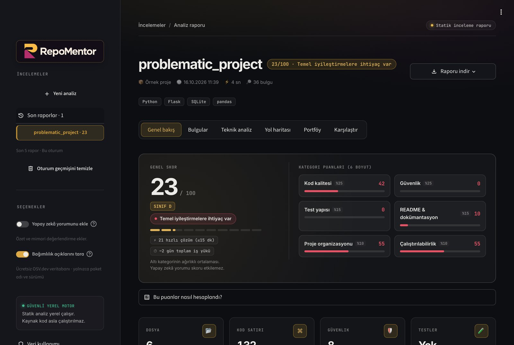

Daha fazlası için [ekran görüntüleri](#ekran-görüntüleri) bölümüne bakın.

---

## Neden?

Küçük ve orta ölçekli projelerde geliştiriciler genellikle şunları bilemez:

- Projem objektif olarak ne durumda?
- Kodda fark etmediğim güvenlik riskleri var mı (açıkta API anahtarı, `eval`, SQL enjeksiyonu…)?
- Hangi iyileştirmeyi **önce** yapmalıyım?
- Bu projeyi CV'de ve LinkedIn'de nasıl anlatırım?
- Yapay zekâ ile yazdığım kod gerçekten kaliteli mi?

RepoMentor AI bu sorulara tek ekranda cevap verir.

## Özellikler

- **İki giriş yolu:** public GitHub bağlantısı (alt klasör dahil) veya ZIP yükleme, ayrıca 5 hazır örnek proje
- **Proje tanıma:** proje türü, framework (FastAPI, Flask, Django, Streamlit…), veri tabanı, ML kütüphaneleri, test aracı, Docker, CI
- **Veri akışı (taint) analizi:** kullanıcı girdisinin değişkenler ve fonksiyonlar boyunca izlenip `eval`, SQL, kabuk komutu, dosya yolu, `pickle`, şablon, SSRF, yönlendirme veya HTML'e ulaşıp ulaşmadığı **kaynaktan hedefe yoluyla** gösterilir
- **Kod kalitesi:** bilişsel ve döngüsel karmaşıklık, Maintainability Index, uzun fonksiyonlar, çok parametreli fonksiyonlar, satır bazlı tekrar ve **yapısal kopyalar**, tip ipucu kapsamı, çıplak `except`, Ruff lint
- **Kullanılmayan kod ve statik test erişimi:** proje genelinde kurulan çağrı grafiğiyle hiçbir giriş noktasından ulaşılmayan fonksiyon/sınıflar ve **hiçbir testin çağırmadığı** fonksiyonlar (testler çalıştırılmadan)
- **Kontrol akışı:** fonksiyon başına kontrol akış grafiğiyle **erişilemeyen kod** ve erken `return` ya da `except` yolunda **kapatılmayan dosya / veritabanı bağlantıları**
- **Veri bilimi kontrolleri:** train/test ayrımından önce `fit` edilen ölçekleyiciler ve test verisine `fit` gibi **veri sızıntıları**; `iterrows`, `apply(axis=1)`, zincirli indeksle atama, `DataFrame.append` gibi yavaş/hatalı pandas kalıpları
- **README komut doğrulayıcı:** README'deki `python main.py`, `uvicorn app.main:app`, `pip install -r …`, `make test` gibi komutların projede gerçekten çalışıp çalışmayacağı (`cd` adımları izlenerek, hiçbir komut çalıştırılmadan)
- **Doğrulanmış güvenlik düzeltmeleri:** bulunan SQL enjeksiyonu parametreli sorguya, komut enjeksiyonu kabuksuz argüman listesine çevrilir; düzeltilmiş kod veri akışı analizinden yeniden geçirilir ve açık gerçekten kapanmıyorsa düzeltme önerilmez
- **Otomatik düzeltme yaması:** güvenlik düzeltmeleri, `yaml.load` → `yaml.safe_load`, çıplak `except`, eksik `.gitignore` / `.env.example` ve Ruff'ın güvenli düzeltmeleri; proje dosyalarına dokunulmadan `git apply` ile uygulanacak bir yama olarak
- **Jupyter Notebook desteği:** kod hücreleri sırasıyla tek bir betik gibi analiz edilir; hücreler arası veri sızıntısı, veri akışı ve notebook'lara yazılmış anahtarlar yakalanır, bulgular "hücre 7, satır 4" olarak gösterilir. `%matplotlib`, `!pip` gibi IPython komutları analizi bozmaz
- **GitHub Action ve PR yorumu:** her pull request'te temel dala göre skor farkı, yeni ve giderilen bulgular tek bir yorumda; en düşük skor ve en fazla düşüş kalite kapısı olarak kullanılabilir
- **Etkileşimli kod haritası:** proje klasör → dosya hiyerarşisinde tıklanıp içine girilebilen bir harita; alan satır sayısını, renk riski, bilişsel yükü ya da bulguları gösterir, ipucunda dosyanın ilk bulguları yazar
- **Saldırı yolu diyagramı:** her doğrulanmış veri akışı, kullanıcı girdisinden değişkenler ve fonksiyonlar üzerinden tehlikeli çağrıya uzanan bir grafik olarak çizilir
- **README rozeti:** "RepoMentor AI 96/100" rozeti tek satırla kendi README'nize; SVG olarak da indirilebilir
- **Mimari:** modül bağımlılık grafiği, **döngüsel import** tespiti ve modül bağlılık ölçütleri (Ca, Ce, kararsızlık)
- **Teknik borç ve öncelik:** SQALE yöntemiyle A–E bakım notu ve "önce bu dosyalara bakın" risk sıralaması
- **Güvenlik:** gizli anahtar taraması (maskelenmiş; adı geçmeyen rastgele anahtarlar için **Shannon entropisi**), depoya girmiş `.env`, `.gitignore` kontrolü, AST kuralları (`eval`, `shell=True`, string ile kurulmuş SQL, `pickle`, `yaml.load`, `verify=False`, debug modu), Bandit
- **Bağımlılık açıkları (OSV.dev):** sürümü kesin olan paketler (`==`, `poetry.lock`, `uv.lock`, `Pipfile.lock`, `pdm.lock`) ücretsiz OSV.dev veritabanında aranır; her paket için CVE'ler, ciddiyet (GitHub değerlendirmesi ya da CVSS v3 puanı) ve **tüm açıkları kapatan en küçük güvenli sürüm** gösterilir. Büyük sürüm atlamalarında değişiklik notu uyarısı verilir
- **Test ve dokümantasyon:** test sayısı/oranı, CI'da test, README bölümleri, lisans, `.env.example`, docstring kapsamı
- **Şeffaf 100'lük skor:** her puanın gerekçesi gösterilir; skor **yalnızca** ölçülebilir kurallardan hesaplanır
- **Önceliklendirilmiş bulgular:** her biri için dosya/satır, neden önemli, nasıl düzeltilir, tahmini süre
- **Bulgu çalışma alanı:** dosya/kural/metin araması, kategori ve önem filtresi, hızlı çözüme göre sıralama, sayfalama ve filtrelenmiş CSV çıktısı
- **Oturum geçmişi:** son 5 rapora geri dönme; iki raporun skorunu, kategori puanlarını ve yeni/artık görünmeyen bulgularını karşılaştırma
- **Yeni tasarım:** açık/koyu temaya uyumlu çalışma alanı, skor halkası, renkli kategori göstergeleri, mobil yerleşim ve tek tıkla örnek analiz
- **Yol haritası:** "İlk 30 dakikada / İlk 2 saatte / İlk 1 günde" planı
- **Görev takibi:** her rapora özel tamamlandı işaretleri ve işaretleri koruyan indirilebilir Markdown planı; işaretler analiz skorunu değiştirmez
- **Yapay zekâ yorumu (isteğe bağlı):** proje özeti, mimari ve okunabilirlik değerlendirmesi, ek öneriler
- **Kariyer çıktısı:** CV maddeleri, LinkedIn proje açıklaması ve gönderi taslağı
- **Hazır README taslağı:** tespit edilen kurulum ve çalıştırma komutlarıyla doldurulmuş şablon
- **Dışa aktarma:** Markdown, JSON ve CSV rapor; CSV içinde proje bilgisi, genel/kategori skorları ve tüm bulgular
- **CLI ve CI:** `python -m repomentor . --min-score 80` ile GitHub Actions'ta kalite kapısı

## Ekran görüntüleri

<table>
  <tr>
    <td width="50%">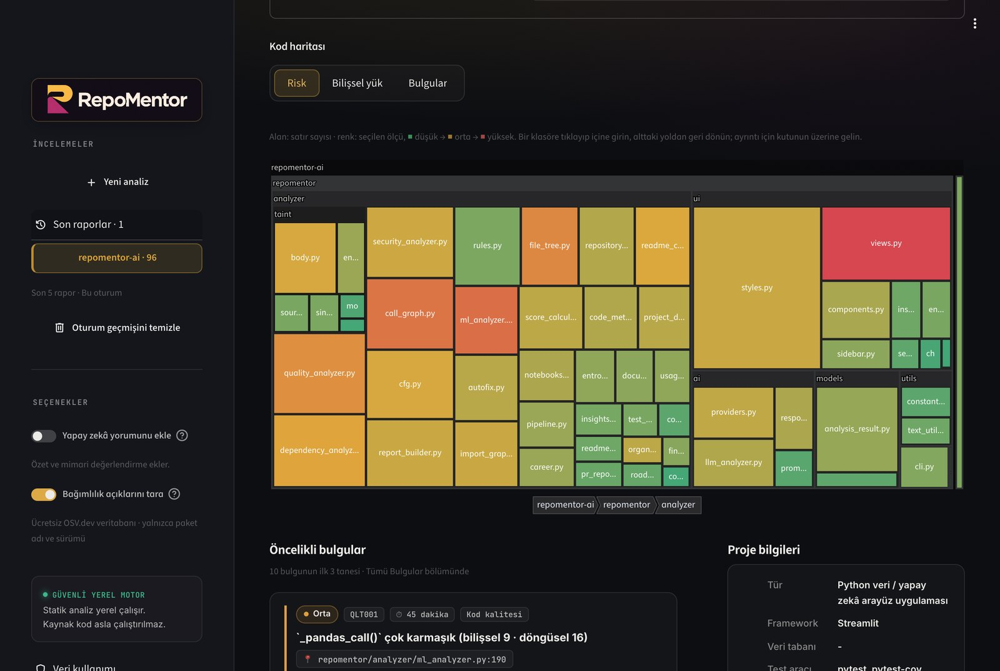<br>
      <sub><b>Kod haritası:</b> RepoMentor'un kendi deposu; alan satır sayısı, renk risk. Klasöre tıklayınca içine girer</sub></td>
    <td width="50%">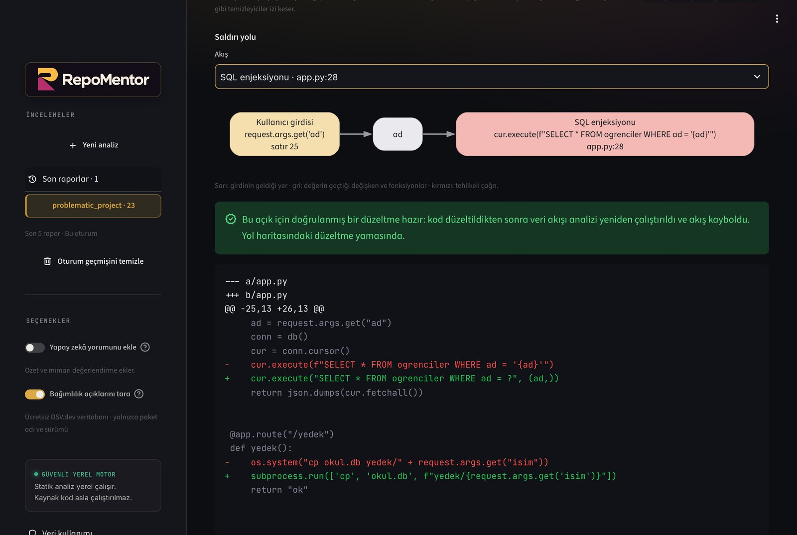<br>
      <sub><b>Saldırı yolu ve düzeltmesi:</b> <code>request.args</code> → <code>ad</code> → <code>cur.execute()</code>; altında yeniden analizle doğrulanmış parametreli sorgu</sub></td>
  </tr>
  <tr>
    <td width="50%">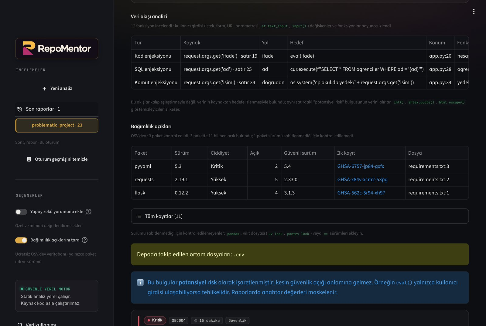<br>
      <sub><b>Güvenlik:</b> kullanıcı girdisinin <code>eval</code>, SQL ve kabuk komutuna kaynaktan hedefe ulaştığı yollar; paket açıkları ve güvenli sürümler</sub></td>
    <td width="50%">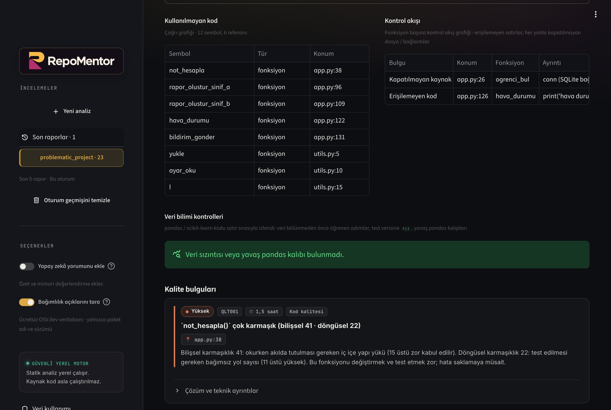<br>
      <sub><b>Kod sağlığı:</b> çağrı grafiğine göre kullanılmayan fonksiyonlar, erişilemeyen kod ve kapatılmayan SQLite bağlantısı</sub></td>
  </tr>
  <tr>
    <td>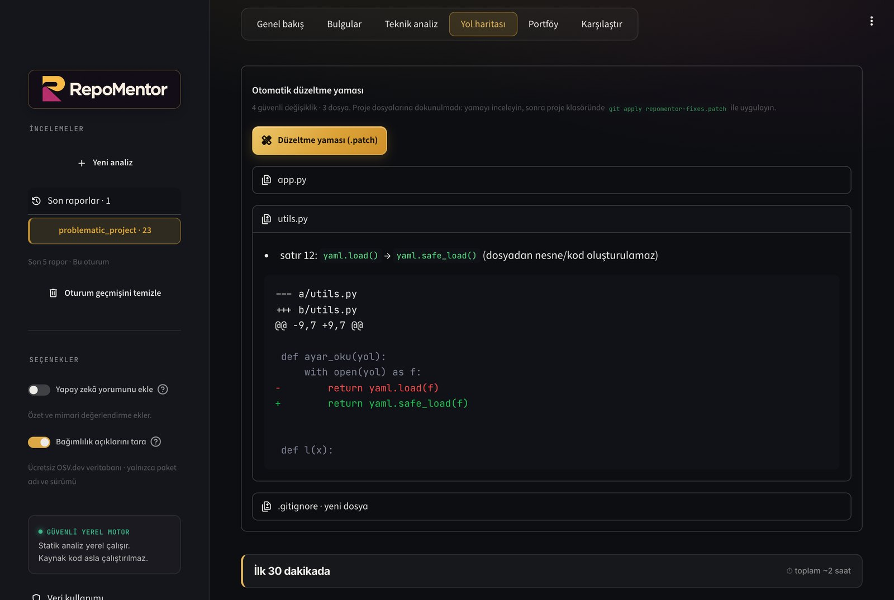<br>
      <sub><b>Otomatik düzeltme:</b> <code>git apply</code> ile uygulanacak yama ve dosya bazında diff önizlemesi</sub></td>
    <td>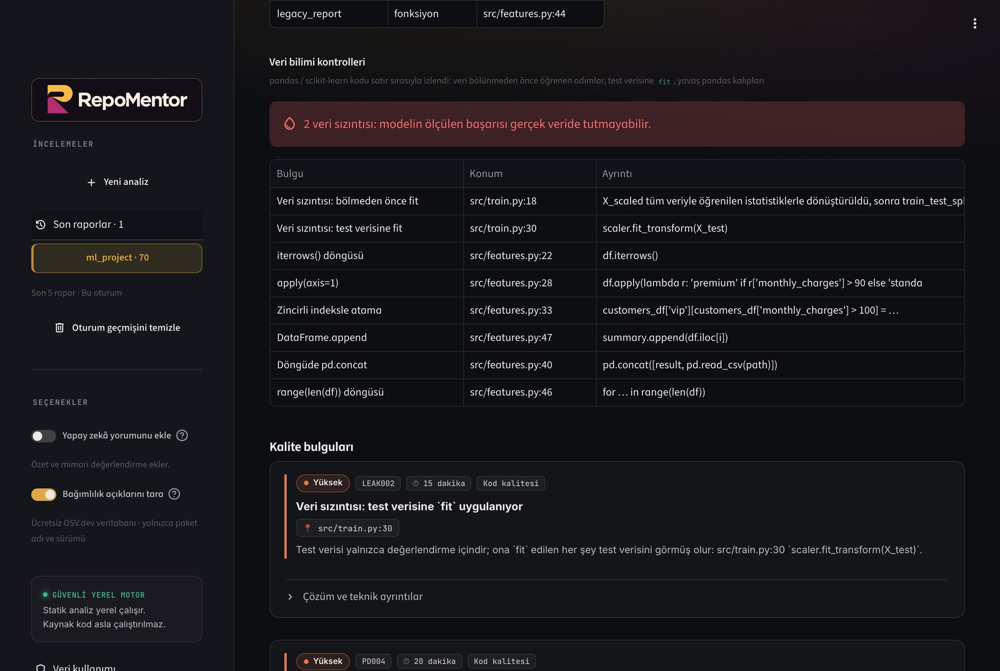<br>
      <sub><b>Veri bilimi:</b> bölmeden önce <code>fit</code>, test verisine <code>fit</code> ve yavaş pandas kalıpları</sub></td>
  </tr>
  <tr>
    <td>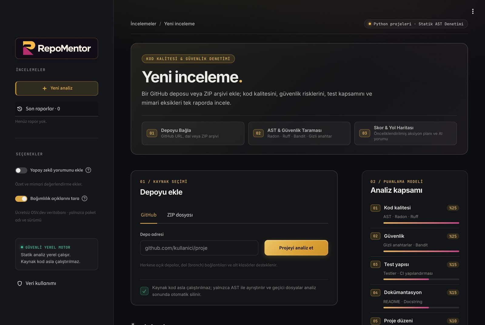<br>
      <sub><b>Başlangıç:</b> GitHub bağlantısı ya da ZIP ile yeni inceleme ve puanlama modeli</sub></td>
    <td>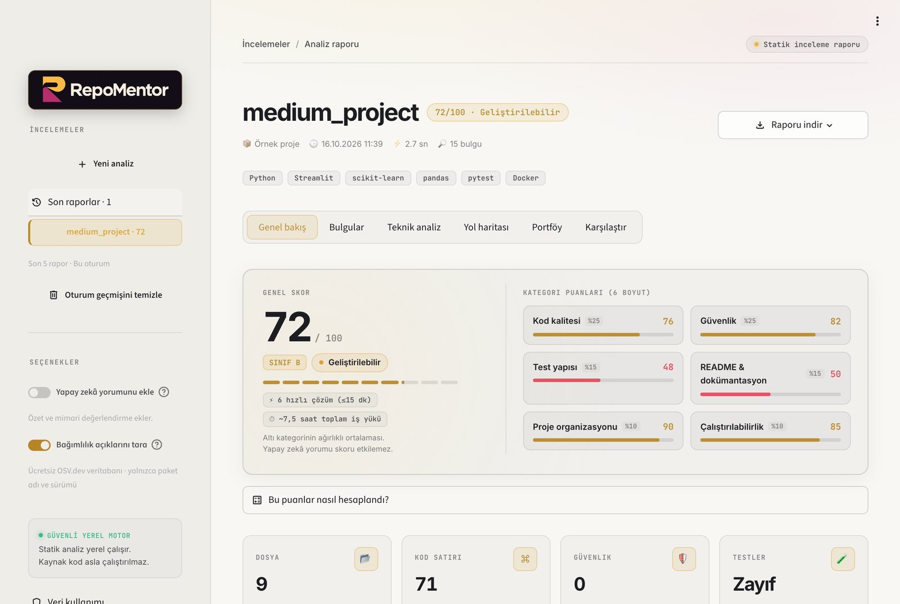<br>
      <sub><b>Açık tema:</b> arayüz sistemin açık/koyu tercihini izler</sub></td>
  </tr>
</table>

<p align="center">
  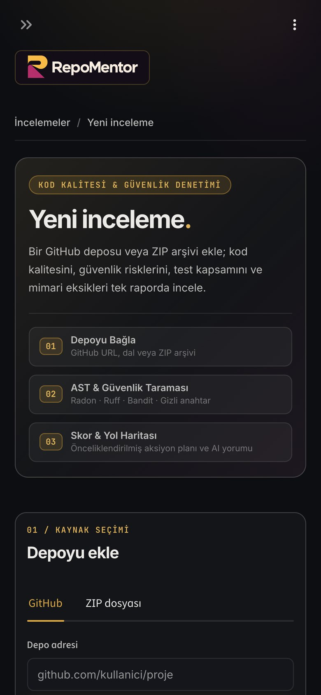
  &nbsp;
  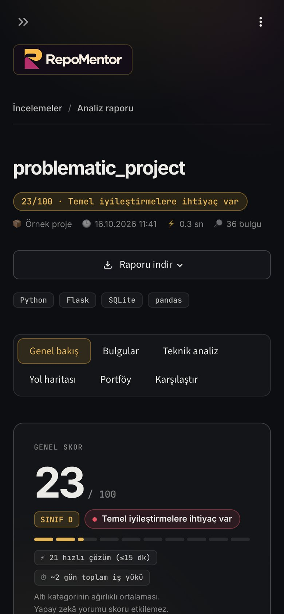
</p>

## Kullanılan teknolojiler

| Alan | Teknoloji |
|---|---|
| Arayüz | Streamlit, Altair |
| Statik analiz | Python `ast`, Radon (karmaşıklık, bakım endeksi), Ruff (lint), Bandit (güvenlik) |
| Yapay zekâ | Ollama (yerel), Groq, Google Gemini, OpenRouter — tek bir `requests` tabanlı istemci, SDK yok |
| Veri kaynağı | GitHub arşiv indirme + REST API (meta veri), OSV.dev açık veritabanı (ücretsiz, anahtarsız) |
| Test ve CI | pytest, GitHub Actions (Python 3.11 / 3.12 / 3.13) |
| Dağıtım | Docker, Streamlit Community Cloud |

## Nasıl çalışır?

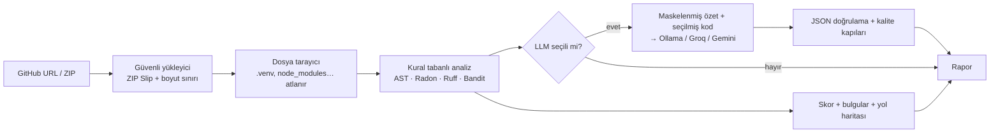

**Tasarım ilkesi:** ölçülebilen her şey kodla ölçülür; yapay zekâ yalnızca yorum gerektiren işler için kullanılır. LLM'e bütün depo değil, statik analiz özeti ve en açıklayıcı birkaç dosya (giriş noktası, en karmaşık modüller) gönderilir. Bu yaklaşım ücretsiz katmanların token sınırlarına sığar ve modeli sayım yapmak yerine yorumlamaya odaklar.

Küçük modellerin tipik hatalarına karşı **kalite kapıları** vardır:

- Model statik analizin zaten bulduğu bir sorunu tekrar ederse veya ölçülmüş bir gerçekle çelişirse (ör. README varken "README yok" derse) o öneri elenir.
- Dosya ağacında olmayan dosya yolları silinir.
- CV maddeleri "geliştirdim" kipinde değilse şablon metne dönülür.
- Bozuk JSON onarılır, gerekirse istek bir kez daha gönderilir.

## Analiz motoru: kendi algoritmalarımız

Hazır araçlar (Radon, Ruff, Bandit) satır ve kalıp düzeyinde çalışır. RepoMentor'un çekirdeği, bunların cevaplayamadığı soruları cevaplayan kendi algoritmalarıdır. Hepsi saf Python ve `ast` modülüyle yazılmıştır; proje kodu hiçbir zaman çalıştırılmaz.

### 1. Veri akışı (taint) analizi — `repomentor/analyzer/taint/`

Kalıp kuralı `eval(x)` gördüğünde yalnızca "potansiyel risk" diyebilir. Taint analizi ise verinin nereden geldiğini izler:

```text
request.args.get('ad') (app.py:25) → ad → cur.execute(f"... WHERE ad = '{ad}'") (app.py:27)   ⇒ SQL enjeksiyonu (kritik)
```

- **Kaynaklar:** `request.args/form/json/…`, Flask / FastAPI route parametreleri, `st.text_input`, `st.query_params`, `input()`, `sys.argv`.
- **Hedefler (9 tür):**
  - kod çalıştırma (`eval`/`exec`)
  - kabuk komutu
  - SQL
  - dosya yolu
  - güvensiz nesne yükleme (`pickle`/`yaml`)
  - şablon (SSTI)
  - SSRF
  - açık yönlendirme
  - XSS (`Markup`, `unsafe_allow_html`)
- **Yayılım:** atama, f-string, birleştirme, metot çağrıları, kapsayıcılar ve döngüler üzerinden izlenir. Fonksiyonun üst düzeyinde akışa duyarlıdır: değişkene temiz bir değer yeniden atanırsa iz silinir.
- **Fonksiyonlar arası:** her fonksiyon için şu özetler, değişiklik kalmayana kadar (sabit nokta) yeniden hesaplanır:
  - "parametre n bir hedefe ulaşıyor"
  - "parametre n dönüş değerine akıyor"
  - "fonksiyon kendi başına kullanıcı girdisi döndürüyor"

  Böylece başka bir modüldeki `run_backup(folder) → os.system(...)` gibi yardımcıların içindeki açıklar da bulunur.
- **Yanlış alarm kalkanları:**
  - Temizleyiciler (`int`, `shlex.quote`, `html.escape`, `secure_filename`…) izi keser.
  - Host'u sabit bir URL (`f"https://api.github.com/{x}"`) SSRF sayılmaz.
  - Tipli FastAPI parametreleri (`item_id: int`) doğrulanmış kabul edilir.
  - Projenin kendi sınıf nesneleri alan bazında izlenmez.
  - Konsol girdisinden gelen akışlar bir ciddiyet seviyesi düşük raporlanır.
  - **Koruma koşulları:** `if not kod.isdigit(): abort(400)` veya `if ad not in IZINLI: return` sonrasındaki kodda değişken temiz sayılır; `if x.isalnum():` dalının içinde de öyle. `isdigit`/`isalnum`/`re.fullmatch`/`is_relative_to` ve sabit bir listeye üyelik kabul edilir. `startswith` bilinçli olarak sayılmaz: `/base/../etc` veya `//evil.com` önek kontrolünü geçer. Koruma yalnızca bir dalda yapıldıysa akış raporlanmaya devam eder.
- Doğrulanmış bir akış, aynı satırdaki "potansiyel risk" bulgusunun yerini alır. RepoMentor'un kendi ~680 fonksiyonunda sıfır akış bulunması bir testle güvence altındadır.

### 2. Bilişsel karmaşıklık — `code_metrics.py`

SonarSource'un tanımladığı yöntemin (G. Ann Campbell, 2017) Python AST'sine uyarlaması. Döngüsel karmaşıklık "kaç test yolu var" sorusunu cevaplar; bilişsel karmaşıklık "okuması ne kadar zor" sorusunu.

- `if`, döngü ve `except` her iç içelik seviyesinde daha pahalıdır.
- `elif` / `else` iç içelik cezası almaz.
- `a and b and c` gibi aynı operatör dizisi tek sayılır.
- Özyineleme +1 sayılır.

Başvuru örnekleri (ör. `sumOfPrimes` = 7) testlerde doğrulanır. 15 üstü "zor" kabul edilir.

### 3. Yapısal kopya tespiti — `code_metrics.py`

Fonksiyon gövdesi normalleştirilir ve özet değeri (hash) karşılaştırılır:
- yalnızca **yerel** değişken adları sırayla `v0, v1…` olur,
- sabit değerler türleriyle değiştirilir,
- dışarıdan çağrılan fonksiyonlar korunur.

Böylece adları değiştirilmiş kopyalar yakalanır, ama `len(x)` ile `sum(x)` yanlışlıkla eşleşmez. Metin bazlı tekrar zaten bulduysa aynı kopya ikinci kez raporlanmaz.

### 4. Modül bağımlılık grafiği — `import_graph.py`

Import'lar göreli import'lar ve `src/` düzeni dahil çözümlenip yönlü bir grafik kurulur. Döngüsel import'lar **Tarjan'ın güçlü bağlı bileşenler algoritmasıyla** (özyinelemesiz) bulunur ve her biri için en kısa somut döngü (`a → b → c → a`) gösterilir.

Fonksiyon içindeki (tembel) import'lar ve `if TYPE_CHECKING:` blokları çalışma anında döngü oluşturmadığı için hariç tutulur. Her modül için Robert C. Martin'in Ca / Ce / kararsızlık ölçütleri hesaplanır.

### 5. Teknik borç ve riskli dosyalar — `insights.py`

- **Teknik borç:** SQALE yöntemi. Bulguların düzeltme süresi, kodu yazma maliyetine (satır başına 30 dk) oranlanır ve A–E notuna çevrilir.
- **Riskli dosyalar (kendi sıralamamız):** her dosya üç eksende sıralanır ve her eksen proje içinde yüzdelik dilime çevrilir. Böylece tek bir dev sayı diğerlerini ezmez.

  | Eksen | Ağırlık |
  |---|---:|
  | Ciddiyete göre ağırlıklı bulgular | %45 |
  | Bilişsel yük | %35 |
  | Boyut | %20 |

  Bulgusu olan bir dosya hiçbir zaman 0 almaz; yalnızca büyük ama temiz bir dosya listeye girmez.

### 6. Çağrı grafiği: kullanılmayan kod ve statik test erişimi — `call_graph.py`, `usage_analyzer.py`

Tüm proje için bir referans grafiği kurulur: modül, sınıf, fonksiyon ve metotlar düğüm; çağrılar, import'lar ve isimle yapılan referanslar kenar olur.

- **Çözümleme:** `self.x()` / `cls.x()` sınıf ve üst sınıflarında, `super()` üst sınıfta, `modul.f()` import edilen modülde, paket `__init__.py` üzerinden yeniden dışa aktarılan isimler kaynağında aranır. Alıcısı bilinmeyen `obj.kaydet()` aynı adlı tüm metotlara bağlanır (yanlış "kullanılmıyor" demektense fazla bağlamak).
- **Dinamik kullanım kalkanları:** `getattr(self, f"handle_{x}")` önekle eşleşen metotları, dekoratörle kaydedilen fonksiyonlar (route'lar, `@pytest.fixture`, `@app.command`), dunder metotlar, dış bir sınıftan türeyen sınıfların metotları ve `__all__` içindeki isimler canlı sayılır.
- **Kullanılmayan kod:** modül kodu, route'lar, testler ve `[project.scripts]` giriş noktalarından BFS ile ulaşılamayan her şey. Kütüphane projelerinde yalnızca `_özel` isimler raporlanır, çünkü public API dışarıdan çağrılır.
- **Statik test erişimi:** aynı grafikte yalnızca testlerden başlanır. Test istemcisi (`TestClient`, `app.test_client()`) kullanan testler route'lara, dosya adını içeren testler (`AppTest.from_file("app.py")`) o modüle ulaşmış sayılır. Sonuç "hangi fonksiyonu hiçbir test çağırmıyor" sorusunu testleri çalıştırmadan cevaplar; skor test/fonksiyon oranı yerine bunu kullanır.

### 7. Kontrol akış grafiği: erişilemeyen kod ve kaynak sızıntısı — `cfg.py`

Her fonksiyon için deyim düzeyinde bir kontrol akış grafiği kurulur. `if`/`elif`, döngüler (`break`, `continue`, `else`), `try`/`except`/`else`/`finally`, `with`, `match` ve `return`/`raise`/`sys.exit()`/`abort()` modellenir. `try` içindeki her deyim `except` bloğuna atlayabilir, `finally` her çıkış yolunda çalışır.

- **Erişilemeyen kod:** girişten hiçbir yolla ulaşılamayan deyimler (`return` sonrası, `while True:` döngüsünden sonra, `if False:` altında). Her ölü bölgenin yalnızca ilk satırı raporlanır; `raise NotImplementedError` sonrasındaki bilinçli `yield` atlanır. `contextlib.suppress` gibi istisnayı yutabilen `with` blokları akışı kesmez.
- **Kaynak sızıntısı:** `with` dışında açılan dosya, SQLite/PostgreSQL bağlantısı, soket veya arşiv için çıkışa giden yollardan biri onu kapatmıyorsa raporlanır. Kapatma (`f.close`), döndürme, `yield`, bir nesneye atama ve başka bir çağrıya verme sahipliği devreder; `json.load(f)` gibi okuyucular yalnızca ödünç alır. Projedeki `def db(): return sqlite3.connect(...)` gibi fabrika fonksiyonları tanınır, böylece `conn = db()` da izlenir. sqlite3'te `with conn:` bağlantıyı kapatmadığı için kapatma sayılmaz.
- **Doğruluk ölçümü:** requests, pandas, numpy, streamlit, rich, jinja2, click, pygments, uvicorn dahil 27 kütüphanede 6 bulgu çıktı ve elle incelendiğinde hepsi gerçek: örneğin requests'te hiç kapatılmayan bir `ZipFile` ve pandas'ta `while True` döngüsünden sonra asla çalışmayan bir satır. Bu kütüphaneler yanlış alarm kalkanlarını (bayrakla korunan kapatma, `sys.exit`, `socket(fileno=…)`) ayarlarken de kullanıldı; yeni projelerde sonuç farklı olabilir.

### 8. Veri sızıntısı ve pandas kalıpları — `ml_analyzer.py`

pandas veya scikit-learn kullanan projelerde her fonksiyon deyim sırasıyla izlenir:

- **LEAK001:** istatistik öğrenen bir adım (`StandardScaler`, `SimpleImputer`, `TfidfVectorizer`, `SMOTE`…) tüm veriye `fit` edilmiş ve aynı veri **sonra** `train_test_split`, `cross_val_score` veya `GridSearchCV`'ye girmiş. Bu durumda test verisinin istatistikleri eğitime sızar.
- **LEAK002:** `X_test`, `x_val`, `holdout` gibi değerlendirme verisine `fit`.
- **pandas:** `iterrows()`, `apply(axis=1)`, zincirli indeksle atama (`df['a'][mask] = …`), kaldırılmış `DataFrame.append`, döngü içinde `pd.concat`, `range(len(df))` döngüleri.

Doğru kullanım (önce böl sonra `fit`, `make_pipeline`) testlerde işaretlenmediği doğrulanan örneklerle korunur. Veri sızıntısı kalite skorundan yüksek ceza alır, çünkü modelin ölçülen başarısını geçersiz kılar.

### 9. README komut doğrulayıcı — `readme_commands.py`

README'deki kabuk blokları ve satır içi komutlar okunur. `&&`, `;` ile bağlanan komutlar ayrılır, `$ ` istemleri ve `FLASK_APP=…` ortam atamaları atılır, `cd` adımları izlenir. Ardından her komut projeye karşı kontrol edilir:

- `python x.py` / `python -m paket`: dosya veya modül var mı?
- `uvicorn app.main:app`: modül var mı, içinde `app` tanımlı mı?
- `pip install -r`, `cp .env.example .env`, `docker build`, `docker compose`: başvurulan dosyalar var mı?
- `pytest`: projede test var mı? `make hedef`: Makefile'da bu hedef var mı?

Bilinmeyen araçlar tahmin edilmez, atlanır. Satır içi kod, cümlesi okuyucuya bir şey yaptırıyorsa kontrol edilir ("`python app.py` ile başlatın", "Run `make test`" gibi). Örnek listeleri, sorular ve `<dosya>` ya da `…` içeren yer tutucular açıklama sayılıp atlanır. README'de hiç kabuk bloğu yoksa talimat fiili aranmaz; o zaman satır içi kod okuyucunun tek kaynağıdır. Bu README'nin kendi ~60 komutunun çalışır olması bir testle güvence altındadır.

### 10. Entropi ile anahtar tespiti — `entropy.py`

`client = Client("Xb9…")` gibi adı "key" ya da "token" olmayan sabit anahtarlar isme dayalı kuralları geçer. Shannon entropisi (karakter başına bit) rastgele metni kelimelerden ayırır:

| Metin türü | Entropi (karakter başına bit) |
|---|---|
| İngilizce metin | ≈ 3,5–4 |
| Rastgele base64 | ≈ 6 |

Eşikler: 32+ karakterlik hex için 3,0; diğer token alfabeleri için 20+ karakterde 4,3. Yanlış alarmı önlemek için şunlar dışarıda bırakılır:

- UUID'ler, düzenli ifadeler
- `hash`, `version`, `color`, `path`, `id` gibi bağlamlar
- birkaç rakam taşıyan uzun tanımlayıcılar (`LongClassName2`)
- test ve örnek dosyalar

Bulunan değer raporda maskelenir (`T08***A4`).

### 11. Otomatik düzeltme yaması — `autofix.py`

Yalnızca çalışan bir programı bozamayacak düzeltmeler yapılır:

- `yaml.load(x)` → `yaml.safe_load(x)` (yalnızca Loader verilmemişse; PyYAML 6'da Loader'sız çağrı zaten hata verir)
- çıplak `except:` → `except Exception:`
- `.gitignore` oluşturma veya `.env` ekleme
- kodun okuduğu ortam değişkenlerinden boş değerli `.env.example`
- Ruff'ın **güvenli** düzeltmeleri: kullanılmayan import (`__init__.py` ve testler hariç), yer tutucusuz f-string, sabitle `is`, gereksiz `;`
- **Enjeksiyon düzeltmeleri** (`security_fixes.py`), yalnızca doğrulanmış veri akışları için:

  ```text
  cur.execute(f"... WHERE ad = '{ad}'")        →  cur.execute("... WHERE ad = ?", (ad,))
  cur.execute(f"... LIKE '%{q}%'")             →  cur.execute("... LIKE ?", (f"%{q}%",))
  os.system("cp okul.db yedek/" + isim)        →  subprocess.run(["cp", "okul.db", f"yedek/{isim}"])
  subprocess.run("tar czf b.tgz " + d, shell=True)  →  subprocess.run(["tar", "czf", "b.tgz", d])
  ```

  Yer tutucu, projenin içe aktardığı sürücüye göre seçilir: sqlite3 için `?`, psycopg / PyMySQL / MySQL Connector için `%s` (sabit metindeki `%` o zaman `%%` olur). SQL'deki `''` kaçışı ve tırnaksız sayısal değerler doğru işlenir; `os.system` dönüşü kullanılıyorsa `.returncode` eklenir, gerekiyorsa `import subprocess` modül başına eklenir. Emin olunamayan hiçbir şeye dokunulmaz: bilinmeyen sürücü, çift tırnaklı tablo/sütun adı, `{x!r}` biçimlendirmesi, parametresi zaten olan çağrı, boru / yönlendirme / `$DEĞİŞKEN` gibi kabuk sözdizimi, başka bir dosyadaki yardımcı fonksiyonun içindeki hedef. Her düzeltme tek başına uygulanıp proje **veri akışı analizinden yeniden geçirilir**; o dosyadaki aynı türden akış sayısı azalmıyorsa düzeltme atılır. `eval()` için mekanik bir düzeltme yoktur (`ast.literal_eval` anlamı değiştirir), bu yüzden önerilmez.

`== None` → `is None` gibi pandas nesnelerinde davranışı değiştirebilecek "unsafe" düzeltmeler bilinçli olarak yapılmaz. Dosyalar bayt olarak yeniden okunur, böylece CRLF satır sonları ve Türkçe karakterlerin sütunları korunur. Düzeltilen her Python dosyasının hâlâ ayrıştırılabildiği kontrol edilir. Çıktı, `git apply` / `patch -p1` ile uyumlu bir yamadır ve **proje dosyalarına hiçbir zaman yazılmaz**.

### 12. Jupyter Notebook'lar — `notebooks.py`

Notebook hücreleri ortak bir isim alanında yukarıdan aşağı çalışır: 7. hücrede `fit` edilen ölçekleyici ile 9. hücredeki `train_test_split` tek bir sızıntıdır. Bu yüzden kod hücreleri sırasıyla, her biri `# %% [hücre N]` işaretiyle başlayan tek bir sanal betiğe dizilir ve bütün analizler onu bir `.py` dosyası gibi okur.

- `%matplotlib inline` ve `!pip install` satırları `pass` olur, `files = !ls` → `files = None`; satır numaraları kaymaz.
- `%%time` gibi Python kalan hücre komutları korunur; `%%bash`, `%%sql` gibi başka dile geçen hücreler ve ayrıştırılamayan hücreler boş bırakılıp raporda listelenir.
- Python dışı çekirdekler (R, Julia) ve hücre çıktıları okunmaz; çıktılar (görseller) yüzünden büyük notebook'lar için boyut sınırı 5 MB'tır.
- Analiz bitince sonuçtaki her sanal satır, konumlarda ve bulgu metinlerinde "`analiz.ipynb › hücre 9:2`" biçimine çevrilir.
- Ruff, Bandit ve otomatik düzeltme diskteki dosyayı okuduğu için yalnızca `.py` dosyalarında çalışır.

## Ücretsiz yapay zekâ seçenekleri

| Sağlayıcı | Maliyet | Gizlilik | Not |
|---|---|---|---|
| **Ollama** (isteğe bağlı) | Ücretsiz, yerel | Kod bilgisayarınızdan **çıkmaz** | Yerel model seçimi |
| **Groq** | Ücretsiz katman | Bulut | Çok hızlı; dakikalık/günlük token sınırı var |
| **Google Gemini** | Ücretsiz katman | Bulut; ücretsiz katman verileri ürün geliştirmede kullanılabilir | Büyük bağlam penceresi |
| **OpenRouter** | Yalnızca `:free` modeller | Bulut | Ücretli modeller listelenmez |
| **Kapalı** | Ücretsiz | Hiçbir veri gönderilmez | Skor, bulgular, yol haritası ve CV metni yine üretilir |

Model listeleri sağlayıcıdan **canlı** alınır; ücretsiz katman sınırları sık değiştiği için kodda model adı sabitlenmemiştir. Sınır aşılırsa (HTTP 429) uygulama birkaç kez yeniden dener; olmazsa kural tabanlı rapora sorunsuzca geri döner.

## Kurulum

Gereksinim: Python 3.11+

```bash
git clone https://github.com/yes3760/repomentor-ai.git
cd repomentor-ai
python -m venv .venv
source .venv/bin/activate        # Windows: .venv\Scripts\activate
pip install -r requirements.txt
cp .env.example .env              # isteğe bağlı: bulut LLM anahtarları
```

### Yerel ve ücretsiz LLM: Ollama (önerilen)

```bash
# macOS: brew install ollama   ·  Windows / Linux: https://ollama.com/download
ollama pull qwen2.5-coder:7b
```

Yapay zekâ yorumu varsayılan olarak **kapalıdır**. Yan menüden **Yapay zekâ yorumunu ekle** anahtarını açtığınızda çalışan Ollama otomatik algılanır. Anahtar kapalıyken model listesi istenmez ve LLM çağrısı yapılmaz.

### Bulut seçenekleri (isteğe bağlı)

`.env` dosyasına ya da uygulamanın yan menüsüne ücretsiz bir anahtar girin:

- Groq: <https://console.groq.com/keys> → `GROQ_API_KEY`
- Gemini: <https://aistudio.google.com/apikey> → `GEMINI_API_KEY`
- OpenRouter: <https://openrouter.ai/keys> → `OPENROUTER_API_KEY`

## Kullanım

### Web arayüzü

```bash
streamlit run app.py
```

Tarayıcıda `http://localhost:8501` açılır. Bir GitHub bağlantısı girin, ZIP yükleyin veya **Örnek depolar** listesinden hazır bir projeyi inceleyin.

Rapor ekranı altı bölüme ayrılır: **Genel bakış**, **Bulgular**, **Teknik analiz**, **Yol haritası**, **Portföy** ve **Karşılaştır**. Teknik analiz içinde kod kalitesi, güvenlik, testler, README ve dosya gezgini bulunur. Üstteki **Raporu indir** menüsünden Markdown, JSON, **CSV raporu** veya README taslağını alın. CSV, Türkçe karakterler için UTF-8 BOM içerir; her bulgu satırında proje bilgileri ve skorlar bulunur. Bulgusuz analizlerde de proje ve skor satırı üretilir.

### İyileştirmeden önce / sonra karşılaştırma

1. Projenizi analiz edin; rapor **Raporlarım** menüsüne eklenir.
2. Kodunuzu geliştirin ve **Yeni analiz** ile tekrar yükleyin.
3. **Karşılaştır** bölümünde ilk raporu referans seçin.

Karşılaştırma kural kimliği ve dosya kümesini eşleştirir; satır numarası kaymaları yeni bulgu sayılmaz. Gruplanmış bulguların konum sayısı ve önem düzeyi değişimleri ayrıca incelenmelidir. Farklı projeler seçildiğinde arayüz bunu belirtir. Raporlar ve görev işaretleri yalnızca geçerli tarayıcı oturumundadır; kalıcı saklama yoktur. Altıncı analizde en eski rapor kaldırılır. İhtiyacınız olan raporu oturum bitmeden indirin.

### Komut satırı

```bash
python -m repomentor ./projem                                     # Markdown rapor
python -m repomentor https://github.com/pallets/itsdangerous -o rapor.md
python -m repomentor ./projem --ai ollama --format json -o rapor.json
python -m repomentor ./projem --format csv -o rapor.csv
python -m repomentor . --min-score 80                             # skor < 80 ise çıkış kodu 1
python -m repomentor ./projem --no-osv                            # bağımlılık taraması kapalı: hiçbir ağ isteği yapılmaz
python -m repomentor ./projem --fix-patch duzeltmeler.patch       # güvenli düzeltmeleri yama olarak yaz
python -m repomentor ./projem --baseline ./projem-eski --format pr  # iki sürümü karşılaştıran kısa özet
python -m repomentor . --baseline https://github.com/yes3760/repomentor-ai --max-drop 3   # skor 3 puandan fazla düşerse çıkış kodu 1
```

Yamayı inceledikten sonra proje klasöründe uygulayın:

```bash
git apply --check duzeltmeler.patch && git apply duzeltmeler.patch
```

### GitHub Actions'ta kalite kapısı

Bu depo kendi CI'ında kendini analiz eder ([.github/workflows/ci.yml](.github/workflows/ci.yml)):

```yaml
- run: python -m repomentor . --min-score 80 -o repomentor-report.md
```

### GitHub Action: pull request yorumu

Kendi deponuzda her pull request'i RepoMentor'a inceletmek için `.github/workflows/repomentor.yml` oluşturun:

```yaml
name: RepoMentor
on: pull_request
permissions:
  contents: read
  pull-requests: write
jobs:
  review:
    runs-on: ubuntu-latest
    steps:
      - uses: actions/checkout@v4
      - uses: yes3760/repomentor-ai@main
        with:
          min-score: "70"   # isteğe bağlı: skor bunun altındaysa iş başarısız olur
          max-drop: "3"     # isteğe bağlı: PR skoru 3 puandan fazla düşürürse iş başarısız olur
```

Action, PR'ın temel dalını ayrı bir klasöre çekip iki sürümü karşılaştırır. Skor farkını, kategori puanlarını, yeni ve giderilen bulguları tek bir yorumda yazar; her push'ta yeni yorum açmak yerine aynı yorumu günceller. Rapor iş özetine (job summary) de eklenir; fork'lardan gelen PR'larda yorum izni olmadığında bile oradan okunabilir. Diğer girdiler: `path` (analiz edilecek klasör), `osv` (`"false"`: bağımlılık taraması kapalı), `comment` (`"false"`: yalnızca iş özeti). Çıktılar: `score`, `score-delta`. Bu depo kendi PR'larında aynı Action'ı kullanır ([.github/workflows/repomentor.yml](.github/workflows/repomentor.yml)).

## Skor nasıl hesaplanır?

| Kategori | Ağırlık | Neye bakılır |
|---|---:|---|
| Kod kalitesi | %25 | Eşiği aşan fonksiyon **oranı** (bilişsel ≥ 15 veya döngüsel ≥ 11), çok karmaşık fonksiyonlar, uzun fonksiyon oranı, bakım endeksi, tekrar ve yapısal kopya, kullanılmayan kod, erişilemeyen kod, kapatılmayan kaynak, veri sızıntısı ve pandas kalıpları, lint yoğunluğu, docstring |
| Güvenlik | %25 | Bulgu başına ciddiyete göre ceza (kritik 35, yüksek 18, orta 8, düşük 3) |
| Test yapısı | %15 | Test dosyası, test sayısı, testlerin çağrı grafiğinde ulaştığı fonksiyon oranı (yoksa test/fonksiyon oranı), CI, pytest/coverage ayarı |
| README | %15 | Kurulum, kullanım, özellikler, komut örnekleri, ekran görüntüsü, teknoloji, lisans, uzunluk |
| Organizasyon | %10 | Bağımlılık dosyası, `.gitignore`, modül yapısı, dosya boyutları, lisans, testlerin yeri, döngüsel import |
| Çalıştırılabilirlik | %10 | Bağımlılıklar, giriş noktası, README komutları, Python sürümü, Docker, CI |

Karmaşıklık ve uzunluk cezaları **etkilenen fonksiyonların oranına** göre verilir; böylece büyük projeler sırf büyük oldukları için cezalandırılmaz. Arayüzdeki **"Bu puanlar nasıl hesaplandı?"** bölümü her artı ve eksiyi gösterir.

| Skor | Değerlendirme |
|---|---|
| 90–100 | Çok iyi |
| 75–89 | İyi |
| 60–74 | Geliştirilebilir |
| 0–59 | Temel iyileştirmelere ihtiyaç var |

Örnek projelerle doğrulama: temiz FastAPI projesi **97**, orta seviye Streamlit projesi **76**, veri sızıntılı ML projesi **72**, sorunlu Flask projesi **23** (bağımlılık taraması kapalıyken). RepoMentor kendini **96** ile geçer. Tarama açıkken orta seviye proje, sabitlediği eski `streamlit` ve `pytest` sürümlerindeki güncel açıklar nedeniyle daha düşük puan alır.

> Örnek projelerdeki hatalar demo amacıyla **bilerek** yazılmıştır. `examples/problematic_project`: kodda açık anahtar, `eval` / SQL / kabuk komutu enjeksiyonu, hiç kapatılmayan SQLite bağlantısı (`ogrenci_bul`), `return` sonrası asla çalışmayan bir satır (`hava_durumu`), çıplak `except`, `yaml.load` ve açıklı paket sürümleri (`PyYAML==5.3`, `flask==0.12.2`, `requests==2.19.1`). `examples/ml_project`: veri bölünmeden önce `fit` edilen ölçekleyici, test verisine `fit` ve yavaş pandas kalıpları. `examples/notebook_project`: hücreler arasında veri sızıntısı, notebook'a yazılmış sahte bir anahtar ve kullanılmayan bir fonksiyon. GitHub, depoyu gönderdiğinizde açıklı sürümler için Dependabot uyarısı gösterebilir; "test/demo amaçlı" olarak kapatabilirsiniz.

## Güvenlik ve gizlilik

- Yüklenen proje **hiçbir zaman çalıştırılmaz**; yalnızca okunur ve AST ile ayrıştırılır.
- Dosyalar geçici bir klasöre açılır ve analizden sonra **her durumda silinir**.
- Son 5 raporun metrikleri, maskelenmiş bulguları ve sınırlı kod örnekleri yalnızca oturum belleğinde tutulur; tam proje kaynak kodu saklanmaz. **Oturum geçmişini temizle** ile kaldırılabilir.
- CSV çıktısında depodan gelen formül başlangıçları etkisizleştirilir.
- ZIP arşivlerinde **ZIP Slip** (`../`, mutlak yol), sembolik bağlantı, dosya sayısı ve zip-bomb kontrolleri yapılır.
- `.env`, sertifika ve anahtar dosyaları LLM'e **gönderilmez**; gönderilen kodda parola/anahtar benzeri değerler **maskelenir**.
- Raporlarda gizli değerler maskelenir (`a1b***al`).
- Depodan gelen her metin arayüzde HTML-escape edilir; LLM çıktısındaki uzak görsel ve bağlantılar temizlenir.
- GitHub için tek bir arşiv isteği yapılır; yalnızca public depolar desteklenir.
- Otomatik düzeltmeler proje dosyalarına **yazılmaz**; yalnızca indirilebilir bir yama üretilir. JSON raporu yamanın kaynak satırlarını içermez.
- Bağımlılık taraması açıkken OSV.dev'e **yalnızca paket adı ve sürümü** gönderilir; kaynak kod, dosya adı veya proje adı gönderilmez. Kilit dosyasındaki projenin kendisi (`editable`/yerel paketler) hiç sorgulanmaz. Tarama yan menüden veya `--no-osv` ile kapatılabilir.

## Sınırlar

> Bu araç otomatik bir ön inceleme yapar; **profesyonel bir güvenlik denetiminin yerine geçmez.**

- Derin analiz yalnızca **Python** içindir. Diğer dillerde README, gizli anahtar ve organizasyon kontrolleri çalışır.
- Güvenlik bulguları **potansiyel risk** olarak işaretlenir. Örneğin `eval()` yalnızca kullanıcı girdisi ulaşıyorsa tehlikelidir.
- Karmaşıklık eşikleri (döngüsel 11/21, bilişsel 15/30) bu aracın değerlendirme ölçeğidir.
- Veri akışı analizi statiktir. Şu dinamik yapılar izlenmez:
  - `getattr` ile dinamik çağrılar
  - `globals()`
  - nesnelerin tek tek alanları (alan duyarsız)
  - farklı modüllerde aynı adı taşıyan fonksiyonların ayrımı

  Amaç yanlış alarmdan kaçınmaktır; bulunamayan akış, hatalı bir uyarıdan daha az zararlıdır.
- Kontrol akışı analizi yol duyarsızdır: `if acildi: f.close()` gibi bayrakla korunan kapatmalar bilinçli kabul edilir, `with` dışındaki istisnalar yalnızca `try` bloklarında modellenir.
- Çağrı grafiği `eval`, eklenti sistemleri ve string ile yapılan çağrıları göremez; "kullanılmıyor" denen kodu silmeden önce bu tür kullanımları kontrol edin. Statik test erişimi satır kapsamı değildir.
- Notebook'larda yalnızca kod hücreleri okunur; başka dile geçen ya da ayrıştırılamayan hücreler atlanır ve raporda listelenir. Ruff, Bandit ve otomatik düzeltme notebook'larda çalışmaz.
- Bağımlılık taraması yalnızca **sürümü kesin olan** paketleri kontrol eder. `>=1.0` gibi aralıklarda hangi sürümün kurulacağı bilinemez; bu paketler tahmin yerine "kontrol edilemedi" olarak listelenir. Dolaylı (transitive) bağımlılıklar yalnızca kilit dosyası varsa kontrol edilir.
- Açık verisi her gün güncellendiği için aynı proje farklı günlerde farklı güvenlik skoru alabilir.

Analizden hariç tutmak istediğiniz yolları kök dizindeki `.repomentorignore` dosyasına yazabilirsiniz. Hariç tutulan dosya sayısı raporda gösterilir.

## Proje yapısı

```text
repomentor-ai/
├── app.py                     # Streamlit giriş noktası
├── action.yml                 # GitHub Action: PR yorumu ve kalite kapısı
├── repomentor/
│   ├── analyzer/
│   │   ├── repository_loader.py   # ZIP / GitHub, güvenli açma
│   │   ├── file_tree.py           # tarama, filtreleme, .repomentorignore
│   │   ├── project_detector.py    # proje türü, framework, bağımlılıklar
│   │   ├── documentation_analyzer.py
│   │   ├── test_analyzer.py
│   │   ├── security_analyzer.py   # gizli anahtar, AST kuralları, Bandit, taint bulguları
│   │   ├── entropy.py             # Shannon entropisiyle adı geçmeyen anahtarlar
│   │   ├── taint/                 # veri akışı analizi: kaynaklar, hedefler, koruma koşulları, fonksiyon özetleri
│   │   ├── call_graph.py          # proje geneli referans grafiği
│   │   ├── usage_analyzer.py      # kullanılmayan kod, statik test erişimi
│   │   ├── cfg.py                 # kontrol akış grafiği: erişilemeyen kod, kaynak sızıntısı
│   │   ├── ml_analyzer.py         # veri sızıntısı, pandas anti-pattern'leri
│   │   ├── readme_commands.py     # README komut doğrulayıcı
│   │   ├── autofix.py             # güvenli düzeltmeler, unified diff yaması
│   │   ├── notebooks.py           # notebook kod hücreleri → sanal betik, bulguları hücrelere geri çevirme
│   │   ├── pr_report.py           # pull request özeti: skor farkı, yeni / giderilen bulgular
│   │   ├── security_fixes.py      # SQL / komut enjeksiyonu için doğrulanmış düzeltmeler
│   │   ├── code_map.py            # etkileşimli kod haritası (ECharts treemap)
│   │   ├── badge.py               # README rozeti (shields.io bağlantısı ve SVG)
│   │   ├── code_metrics.py        # bilişsel karmaşıklık, yapısal kopya, tip ipucu kapsamı
│   │   ├── import_graph.py        # modül grafiği, Tarjan ile döngü tespiti, bağlılık ölçütleri
│   │   ├── insights.py            # teknik borç (SQALE) ve riskli dosya sıralaması
│   │   ├── dependency_analyzer.py # OSV.dev bağımlılık açıkları, CVSS v3 hesabı
│   │   ├── quality_analyzer.py    # Radon, Ruff, tekrar tespiti
│   │   ├── organization_analyzer.py
│   │   ├── rules.py               # tüm kuralların kataloğu (metin, ciddiyet, süre)
│   │   ├── score_calculator.py    # deterministik, gerekçeli skor
│   │   ├── roadmap.py · career.py · readme_template.py · report_builder.py
│   │   └── pipeline.py            # kurallar → skor → (isteğe bağlı) LLM
│   ├── ai/
│   │   ├── providers.py           # Ollama / Groq / Gemini / OpenRouter (tek HTTP istemcisi)
│   │   ├── prompts.py · llm_analyzer.py · response_parser.py
│   ├── models/                    # Issue, AnalysisResult (dataclass)
│   ├── ui/                        # Streamlit bileşenleri, grafikler, sekmeler
│   └── cli.py
├── examples/                  # temiz / orta / ML / notebook / sorunlu demo projeleri
├── docs/                      # ekran görüntüleri, LinkedIn metinleri
├── tests/                     # pytest
└── CHANGELOG.md · CONTRIBUTING.md · SECURITY.md
```

## Testler

```bash
pytest
ruff check .
```

Test paketi (329 test, ağa hiç çıkmadan) şunları kapsar: dokuz taint hedefinin her biri, temizleyiciler ve yanlış alarm kalkanları, fonksiyonlar arası akış, SonarSource bilişsel karmaşıklık başvuru örnekleri, yapısal kopyalar, Tarjan ve döngüsel import senaryoları, SQALE not eşikleri, ZIP Slip ve zip-bomb korumaları, gizli değerlerin rapora ve prompt'a sızmaması, her güvenlik kuralının pozitif ve negatif örnekleri, skorların örnek projeleri doğru sıralaması, LLM yanıt ayrıştırıcısı ve sahte LLM ile uçtan uca akış; çağrı grafiğinin dinamik kullanım kalkanları, kontrol akışı (finally, suppress, match, fabrika fonksiyonları), koruma koşullu taint, veri sızıntısı ve doğru ML kodu örnekleri, README komutları, entropi eşikleri ve üretilen yamanın CRLF dosyalara `git apply` ile uygulanması. RepoMentor'un kendi kodunda kullanılmayan kod, erişilemeyen kod ve kaynak sızıntısı olmaması da test edilir. Ek olarak rapor karşılaştırması, satır kaymaları, arama/sıralama, CSV formül koruması ve Streamlit AppTest ile analiz → rapor → görev takibi → karşılaştırma → geçmiş temizliği doğrulanır.

## Ücretsiz yayınlama

**Streamlit Community Cloud** (önerilen, ücretsiz):

1. Depoyu GitHub'a gönderin.
2. <https://share.streamlit.io> → *New app* → depoyu ve `app.py` dosyasını seçin.
3. *Advanced settings → Secrets* bölümüne `GROQ_API_KEY = "..."` ekleyin (bulutta Ollama olmadığı için). Anahtar eklemezseniz uygulama kural tabanlı modda çalışır.

**Hugging Face Spaces** (Docker): yeni bir *Docker Space* oluşturun ve bu depoyu gönderin. Hazır [Dockerfile](Dockerfile) 8501 portunu kullanır.

**Docker (yerel):**

```bash
docker build -t repomentor-ai .
docker run -p 8501:8501 -e OLLAMA_BASE_URL=http://host.docker.internal:11434 repomentor-ai
```

## Yol haritası

- [ ] JavaScript / TypeScript desteği
- [x] Pull request analizi ve iki commit arasındaki kalite farkı
- [x] GitHub Action olarak yayınlama (PR yorumu)
- [ ] Geçmiş raporları saklama ve trend grafiği
- [x] Oturum içi rapor geçmişi ve iki rapor karşılaştırması
- [x] Güvenli otomatik düzeltme yaması
- [ ] Daha fazla otomatik düzeltme (kaynak sızıntısı için `with`, sabit anahtarı ortam değişkenine taşıma)
- [x] Notebook (`.ipynb`) kod hücrelerinin analizi
- [ ] Çoklu dil (TR/EN) arayüz

## Katkı ve güvenlik

- Katkı vermek için: [CONTRIBUTING.md](CONTRIBUTING.md) (kurulum, testler, yeni kural ekleme, tasarım ilkeleri)
- Güvenlik açığı bildirmek için: [SECURITY.md](SECURITY.md) (lütfen herkese açık issue açmayın)
- Sürümler ve değişiklikler: [CHANGELOG.md](CHANGELOG.md)

## Lisans

[MIT](LICENSE) © 2026 Yunus Emre Sevindik
